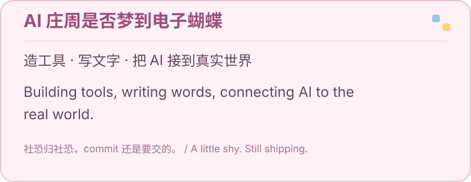

  

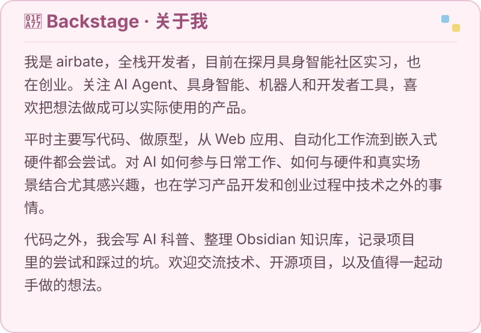

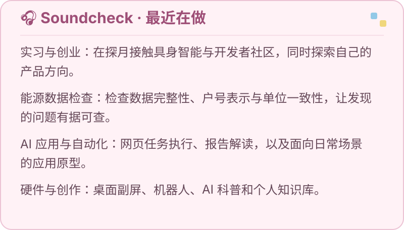

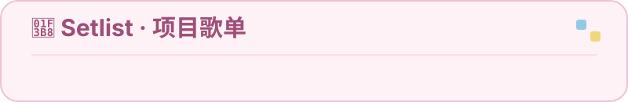

<a href="https://github.com/airbate/openenergydata">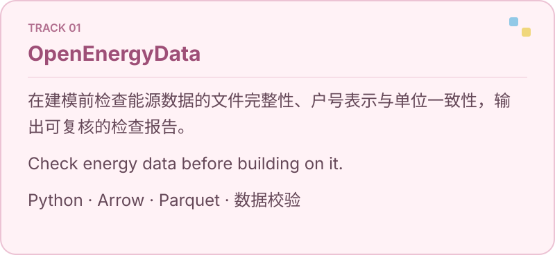</a>

<a href="https://github.com/airbate/porchlight">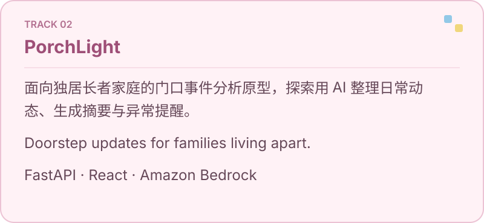</a>

<a href="https://github.com/airbate/flowpilot">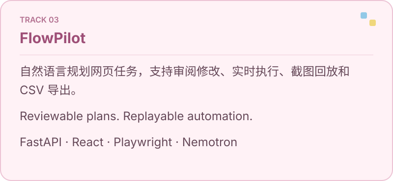</a>

<a href="https://github.com/airbate/lablens">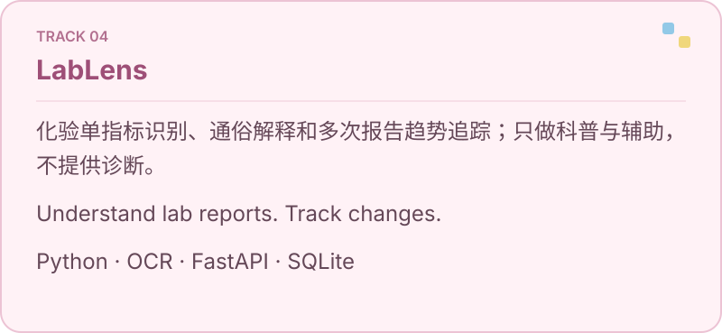</a>

<a href="https://github.com/airbate/Glance">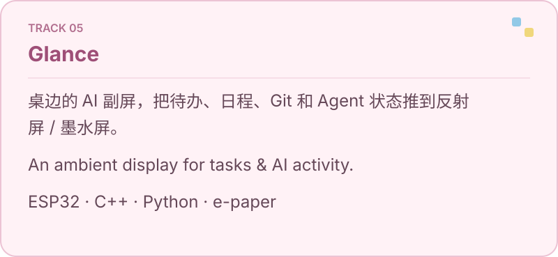</a>

<a href="https://github.com/airbate/shuimo-liuyun">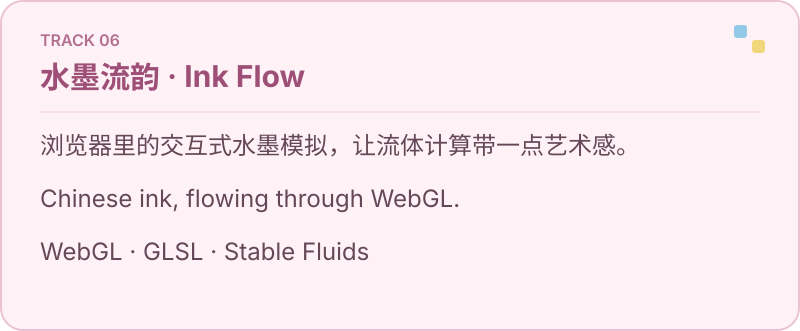</a>

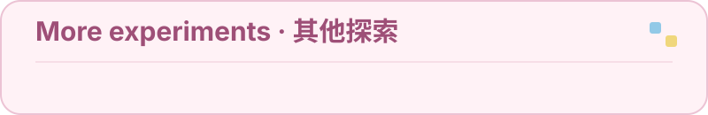

<a href="https://github.com/airbate/limo-person-following">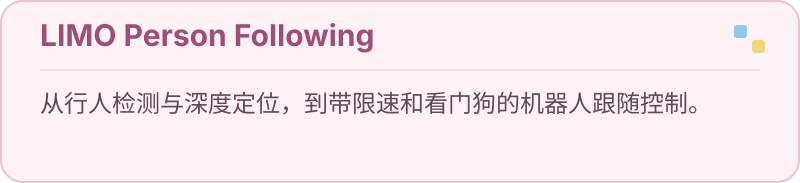</a>

<a href="https://github.com/airbate/ideal-octo-adventure">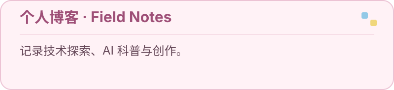</a>

<a href="https://github.com/airbate/mushen">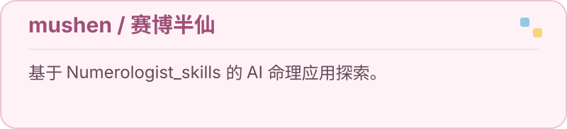</a>

<a href="https://github.com/airbate/Numerologist_skills">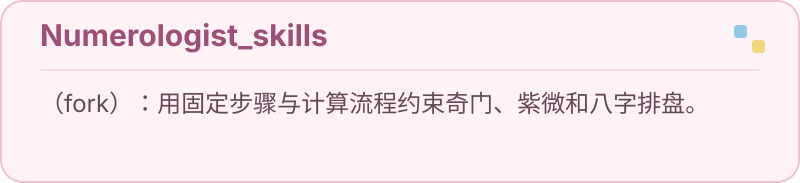</a>

<a href="https://github.com/airbate/ProjectNorthStar">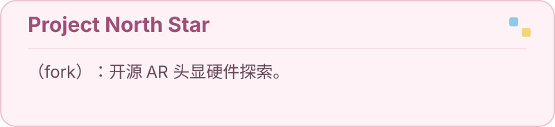</a>

<a href="https://github.com/airbate/wechat-program">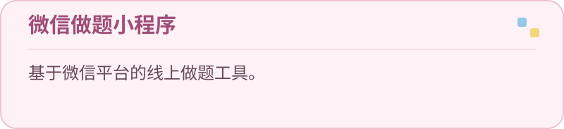</a>

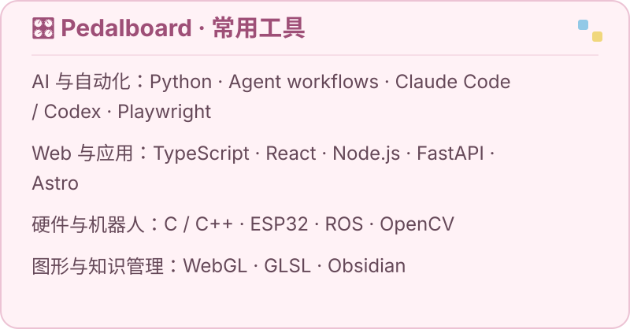

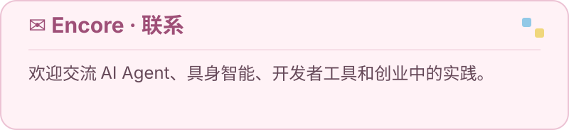

  

